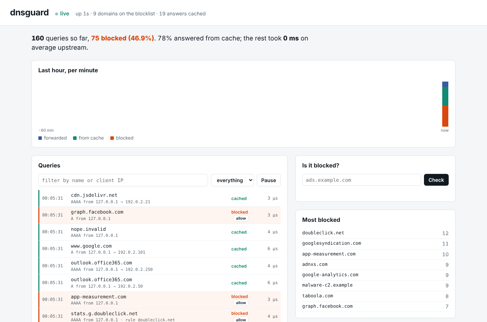

# dnsguard

A DNS sinkhole for your whole network, in one Go binary with no dependencies. Point your router's DNS at it, and every phone, laptop and smart TV behind it stops talking to ad, tracking and malware domains. Everything else gets cached and forwarded over encrypted DNS, and a live dashboard shows what your network is actually looking up.



## Why

Pi-hole is great, but it's PHP + dnsmasq + lighttpd + a database, and it wants a whole Raspberry Pi. For a small office, a client site, or the edge box in a hosting rack I wanted the same idea as one static binary I could drop anywhere: a VPS, a router running Linux, a container, a 512 MB VM.

Building it was also the best way I know to *really* learn DNS: the wire format, name compression, TTLs, EDNS0, truncation and TCP fallback, DoH, DoT.

## Features

- **Blocklists** in every common format: hosts files, plain domain lists, `||adblock^` rules, `*.wildcards`. Load from files or URLs, re-downloaded every 24h. A failed download keeps the previous list, never an empty one.
- **Subdomain matching**: block `doubleclick.net` and `ad.g.doubleclick.net` goes too. **Allowlist** entries win at every level, so you can block `example.com` but allow `cdn.example.com`.
- **Sinkhole mode** (default) answers `0.0.0.0` / `::`, so apps fail fast instead of retrying. Use `-nxdomain` for NXDOMAIN instead.
- **Encrypted upstreams**: DNS-over-HTTPS (RFC 8484), DNS-over-TLS, or plain UDP/TCP. Several upstreams are **ranked by measured latency**, with automatic failover when one fails.
- **Cache**: LRU, TTL-aware, and **TTLs count down** when served from cache (clients see the remaining lifetime, not the original). Negative answers (NXDOMAIN) are cached too. SERVFAIL is never cached.
- **Query collapsing**: ten tabs asking for the same name at the same moment cause *one* upstream query, not ten.
- **Proper UDP/TCP behaviour**: answers over 1232 bytes (the 2020 DNS flag day size), or over what the client advertised via EDNS0, get the TC bit, and the client retries over TCP, which dnsguard also serves.
- **It's a DoH server too**: `/dns-query` on the dashboard port, so phones and browsers can use dnsguard as their encrypted DNS.
- **Dashboard + API**: per-minute chart for the last hour, a live query log (filter by name, client or result), one-click *allow*, "is this blocked and by which rule?", top blocked / top domains / busiest clients, upstream latency and failures. JSON API under `/api/*`, optional bearer token.
- **Private by design**: the query log is in memory only, a ring of the last 5,000. Nothing piles up on disk.

## Run it

```
go install github.com/GreatsLab/dnsguard@latest

sudo dnsguard \
  -block https://raw.githubusercontent.com/StevenBlack/hosts/master/hosts \
  -upstream https://cloudflare-dns.com/dns-query \
  -upstream tls://9.9.9.9#dns.quad9.net
```

Dashboard at http://localhost:8053. Then set your router's DHCP to hand out this machine's IP as the DNS server.

### Docker

```
docker compose up -d
```

[`docker-compose.yml`](docker-compose.yml) runs it as an unprivileged user from a `scratch` image (just the binary and CA certs, about 8 MB), with the dashboard bound to localhost.

### systemd

[`deploy/dnsguard.service`](deploy/dnsguard.service) runs as a dynamic user with only `CAP_NET_BIND_SERVICE` and a read-only filesystem.

## Flags

| flag | default | |
|---|---|---|
| `-listen` | `:53` | DNS, UDP and TCP |
| `-http` | `:8053` | dashboard, API, DoH. Empty to disable |
| `-upstream` | Cloudflare + Quad9 DoH | repeatable: `1.1.1.1`, `tcp://…`, `tls://ip#name`, `https://…` |
| `-block` | | file or URL, repeatable |
| `-allow` | | file or single domain, repeatable |
| `-cache` | `20000` | max cached answers |
| `-nxdomain` | off | NXDOMAIN instead of 0.0.0.0 |
| `-refresh` | `24h` | blocklist re-download interval |
| `-token` | `$DNSGUARD_TOKEN` | require `Authorization: Bearer …` (or `?token=`) for the API |
| `-v` | | log every query |

## API

```
GET  /api/summary                 totals, per-minute counts, top lists, upstream health
GET  /api/queries?n=200&q=&result=blocked
GET  /api/check?name=ads.example.com
POST /api/allow   name=cdn.example.com     (until restart)
POST /api/cache/flush
GET|POST /dns-query                       RFC 8484 DoH
GET  /healthz
```

## How it's built

```
internal/dns      wire format: parse question, walk RRs for TTLs, build sinkhole/error replies
internal/block    list parsing (hosts / domains / adblock), suffix matching, atomic swap on reload
internal/cache    LRU with expiry, copy-on-read
internal/server   UDP+TCP listeners, upstreams (UDP/TCP/DoT/DoH) with latency ranking, query
                  collapsing, stats ring, HTTP dashboard + DoH endpoint
web/              the dashboard, embedded into the binary with go:embed
```

Standard library only, no third-party modules.

## Tests

```
go test -race ./...
```

The server tests start the real resolver against a **fake upstream** on localhost and check: blocking never reaches upstream, the cache answers the second query, cached TTLs count down, NXDOMAIN passes through, 10 concurrent identical queries cause exactly 1 upstream query, failover to the second upstream, the DoH client sends ID 0 (per RFC 8484), the DoH endpoint answers, and the API token is enforced. CI also builds the Docker image and resolves a real name through it.

Bugs the tests caught before I ever ran the binary:

- **Go 1.22 routing conflict.** Registering `/dns-query` (any method) next to `GET /` panics at startup. It's now registered per method.
- **`http://` DoH upstreams** (for a local DoH proxy) were being parsed as hostnames.

And one the browser caught: the first dashboard was blank, because a function named `top()` collides with `window.top` in a classic script.

## Not done yet

- Per-client policies (stricter lists for the kids' tablets)
- Conditional forwarding (`*.lan` → the router)
- Persisting stats across restarts (opt-in)

## License

MIT
